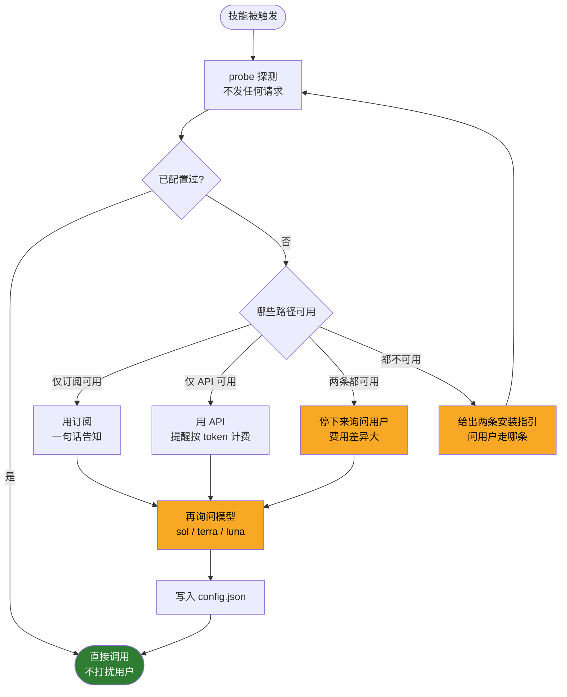
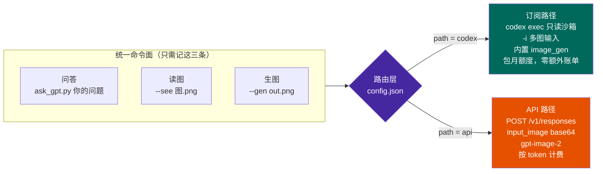

<div align="center">


# ask-gpt

**在 Claude Code 里调用你自己的 OpenAI 账号 —— 问答、读图、生图，一套命令，两条路径**

[](https://docs.claude.com/en/docs/claude-code/skills)
[](https://www.python.org/)
[](scripts/ask_gpt.py)
[](LICENSE)

</div>

---

## 为什么需要它

Claude 很强，但有三类场景它一个人干不了：

| 场景 | 问题 |
|---|---|
| **事实核查** | 单一模型的幻觉自己查不出来。需要另一个模型**独立作答**再比对 |
| **论文润色** | 不同模型的语感差异很大，对照两版再定稿，质量明显高于单版 |
| **生图 / 识图** | 有时你就是想要 `gpt-image-2` 的出图风格，或想听听 GPT 对一张图的判断 |

市面上的做法通常是**让你再掏一份 API 费用**。但很多人已经在付 ChatGPT 包月订阅了 —— 那份额度本来就能用，只是没有顺手的入口。

**ask-gpt 把两条路都接上，并且功能完全对等。**

```
已有 ChatGPT 订阅  → 走 Codex CLI，消耗包月额度，不产生任何额外账单
只有 API Key      → 走 OpenAI API，按 token 计费，尺寸可控、不受订阅额度限制
两条都有          → 技能会停下来问你走哪条（费用差异大，不替你决定）
```

> 真实痛点：本项目的前身版本曾把订阅路径整个删掉、只留 API 直连。结果在一台**有订阅、没有 API Key** 的机器上，技能第一步就卡死 —— 唯一能用的路径被写掉了，写进去的路径没有凭据。v4 的双路径设计就是从这个坑里长出来的。

---

## 核心设计：探测在前，追问在后

每次都问用户"你有订阅还是 API"很烦；完全不问又会在费用上替用户做决定。所以按探测结果分流，**只在真正需要决策时才开口**：



<sub>🟡 黄色 = 需要用户参与的节点，其余全自动</sub>

### 一个容易踩的坑：脚本绝不能等 stdin

技能脚本跑在 Claude 的工具调用里，**没有交互式终端**。如果脚本写了 `input()` 等用户选择，整个调用会直接挂死。

所以本项目的分工是：

- **脚本**：全程非交互，只负责探测（`--probe`）、落盘（`--set-path`）、执行
- **Claude**：用对话里的选择卡片去问用户，拿到答案再调脚本落盘

---

## 架构：一套命令，两条路径



### 能力对照

| 能力 | 订阅路径 `codex` | API 路径 `api` |
|---|---|---|
| **计费** | ChatGPT 包月额度，**零额外账单** | **按 token 计费** |
| **文本模型** | `gpt-5.6-sol` / `terra` / `luna` | 同样三款 |
| **问答** | `codex exec` 只读沙箱 | `POST /v1/responses` |
| **读图** | `codex exec -i`（客户端读文件后上传，可多张） | `input_image` base64 data URL |
| **生图** | 内置 `image_gen` 工具 | `gpt-image-2` |
| **生图尺寸** | 不可指定（由工具决定） | `--size` 精确控制 |
| **额度耗尽** | `usage limit`，等订阅周期重置 | `429` 限速或余额不足 |
| **已知缺陷** | `image_gen` 偶尔只给预览不落盘；Windows/WSL 可能无此工具 | — |

> 模型清单不是硬编码猜的，而是从 Codex 本地缓存 `~/.codex/models_cache.json` 读出来的 —— 实测两条路径恰好是同三款。

---

## 安装

### 1. 装技能

```bash
git clone https://github.com/Stefansong/ask-gpt.git
cp -r ask-gpt ~/.claude/skills/ask-gpt
```

也可以把 `SKILL.md` + `scripts/` 上传到 claude.ai 的技能设置（账号级技能会同步到所有设备）。

> ⚠️ 如果这个技能在你账号里是**同步技能**，直接改本地文件**不会持久** —— 下次同步会被云端覆盖。要改版本请改云端。

### 2. 配认证（二选一，也可以都配）

<table>
<tr><th>订阅路径（推荐，不额外花钱）</th><th>API 路径（按量计费）</th></tr>
<tr valign="top"><td>

```bash
brew install codex
# 或 npm install -g @openai/codex

codex login
# 无浏览器环境：
# codex login --device-auth
```

需 ChatGPT Plus / Pro / Business 等付费账号

</td><td>

```bash
echo 'export OPENAI_API_KEY=sk-...' >> ~/.zshrc
source ~/.zshrc
```

在 [platform.openai.com](https://platform.openai.com) 创建 Key

</td></tr>
</table>

### 3. 探测 + 选路径

```bash
python3 scripts/ask_gpt.py --probe
```

```
订阅(codex): 可用 — Logged in using ChatGPT
  可用模型: gpt-5.6-luna, gpt-5.6-sol, gpt-5.6-terra
API Key:     不可用 — OPENAI_API_KEY 未设置
已配置: 否（需先选路径）
```

```bash
python3 scripts/ask_gpt.py --set-path codex -M gpt-5.6-sol
```

选完就不再追问了。平时直接说「**问问 GPT**」「**让 GPT 看看这张图**」，技能会自动触发。

---

## 使用

### 用法 1 · 问答 / 第二意见

```bash
python3 scripts/ask_gpt.py "2 的 10 次方是多少？"
python3 scripts/ask_gpt.py -f prompt.md          # 长内容走文件，避免 shell 转义
```

```
2 的 10 次方是 1024。
[路径: ChatGPT 订阅 via codex exec，模型 gpt-5.6-sol]
```

回答走 **stdout**，路径与模型标注走 **stderr** —— 方便管道里只取回答。

### 用法 2 · 读图

```bash
python3 scripts/ask_gpt.py --see 图.png "这张图说明了什么？"
python3 scripts/ask_gpt.py --see 图1.png --see 图2.png -f q.md   # 多张重复 --see
```

<table>
<tr><td width="140"></td><td>

```
$ ask_gpt.py --see demo-see-colors.png \
    "左右两半各是什么颜色？只答两个颜色词。"

红色，蓝色
[路径: ChatGPT 订阅 via codex exec，模型 gpt-5.6-sol，1 张图]
```

</td></tr>
</table>

支持 png / jpg / webp / gif。**多图必须重复 `--see`**，不要写 `--see a.png b.png`。

### 用法 3 · 生图

```bash
python3 scripts/ask_gpt.py --gen out.png "一只橘色的猫坐在窗台上，简洁扁平插画风格"
python3 scripts/ask_gpt.py --gen out.png --size 1536x1024 -f desc.txt   # --size 仅 API 路径
```

<table>
<tr><td width="320"></td><td>

```
saved: out.png
[生图路径: ChatGPT 订阅 via Codex image_gen]
```

**生完一定要核对文件存在**（`ls -la`）——
订阅路径的 `image_gen` 有偶尔只给预览
不落盘的已知问题。

这张图本身就是测试产物，随后又用
`--see` 反向识别为"橘白相间的猫坐在
窗台上" —— 生图与读图闭环验证通过。

</td></tr>
</table>

### 临时覆盖 / 配置管理

```bash
python3 scripts/ask_gpt.py --path api -m gpt-5.6-luna "问题"   # 本次换路径和模型，不改默认
python3 scripts/ask_gpt.py --show-config
python3 scripts/ask_gpt.py --reset-config                      # 重新选路径前先清掉
```

### 模型怎么选

| 模型 | 适用 |
|---|---|
| `gpt-5.6-sol` | 最强，推理 / 长文 / 疑难问题（默认） |
| `gpt-5.6-terra` | 均衡，日常问答与润色，速度快 |
| `gpt-5.6-luna` | 最便宜最快，简单任务、批量处理 |

---

## 四种 prompt 组织模式

技能内置了四种工作模式，Claude 会按场景自动选：

1. **直接提问** —— 用户的问题原样转发，不加不减，回答标注出自 GPT
2. **第二意见 / 交叉验证（盲评）** —— 只发原始问题让 GPT 独立作答，**不附上 Claude 已有的结论**，避免锚定效应；拿到回答后汇报三部分：一致点、分歧点、综合判断
3. **审稿 / 对照润色** —— GPT 修改版与原文**逐段对照**（表格或 diff），交由用户定稿，不擅自合并两版
4. **识图** —— 图片与问题一起发；复杂影像先问清用户想看什么

---

## 必守规则

技能里写进了几条硬约束，目的是不让 AI 的便利性盖过可靠性：

- 🏷️ **署名** —— 凡出自 GPT 的内容都标明「GPT（模型名，订阅/API 路径）」，与 Claude 自己的观点分开呈现，绝不静默混用
- 💰 **费用** —— API 路径按 token 计费。批量调用、发大图或连续生图前，先说明大致用量
- 🔒 **隐私** —— 发出前确认不含患者可识别信息（PHI）、密钥、未发表数据；医学影像先去标识化
- ❌ **失败就是失败** —— 任何一步失败都如实报错并给修复命令，**绝不编一个"GPT 的回答"顶替**

### ⚠️ 代理会改写流量

如果你的环境设了 `HTTPS_PROXY` 或 `OPENAI_BASE_URL`，请求可能**经第三方网关转发而非直连 OpenAI**。`--probe` 会把这三个变量的状态一并返回：

```bash
python3 scripts/ask_gpt.py --probe --json | python3 -c "import json,sys; print(json.load(sys.stdin)['proxy'])"
```

```
{'HTTP_PROXY': True, 'HTTPS_PROXY': True, 'OPENAI_BASE_URL': False}
```

**"数据只发给 OpenAI"在有代理的机器上并不成立。** 涉及敏感数据时必须先确认这个环节 —— 开发本项目时就实测到请求被转发到了一个第三方 LLM 网关，而 CLI 自身对此毫不知情。

---

## 报错速查

<details>
<summary><b>订阅路径</b></summary>

| 报错 | 原因 / 处理 |
|---|---|
| `usage limit ... try again at HH:MM` | 包月额度用尽，等重置；若也有 API Key 可临时 `--path api` |
| `未找到 codex 可执行文件` | 脚本已自动查过 PATH、`/opt/homebrew/bin`、`/usr/local/bin`、`~/.local/bin`、ChatGPT.app 内置路径；都没有就是真没装 |
| `codex exec 未返回回答` | 看脚本打印的末尾输出，别猜原因 |
| `403 team not allowed to access model` | 该账号/网关不允许这个模型，换 `terra` / `luna` |

> `codex` 常装在 `/opt/homebrew/bin`，而**非交互 shell 的 PATH 里往往没有这个目录** —— `shutil.which("codex")` 会返回 None。本脚本内置了 5 个候选路径的回退查找，专门绕开这个坑。

</details>

<details>
<summary><b>API 路径</b></summary>

| 报错 | 原因 / 处理 |
|---|---|
| `401` | Key 无效或过期 |
| `429` | 限速或余额不足 |
| `model_not_found` | 模型名已更新，查 `GET /v1/models` 后用 `-m` 指定 |
| `连不上 OpenAI` | 检查 `HTTPS_PROXY` 是否可用 |

</details>

---

## 实测状态

| 测试 | 订阅路径 | API 路径 |
|---|---|---|
| 问答 | ✅ 通过 | ⚠️ 仅验证请求构造与错误处理（401 干净返回） |
| 读图 | ✅ 通过（左红右蓝 → "红色，蓝色"） | ⚠️ 同上，未经真机验证 |
| 生图 | ✅ 通过（1254×1254 PNG） | ⚠️ 同上，未经真机验证 |
| 生图↔读图闭环 | ✅ 通过 | — |
| 两条都可用时拒绝自动选 | ✅ 退出码 2 + 要求选择 | |
| 图片不存在 | ✅ 拦住，退出码 1 | |
| codex 不在 PATH | ✅ 自动回退 | |

**API 路径的真实响应未经真机验证** —— 开发环境没有 API Key，只验证到请求构造正确、错误处理干净。如果你跑通了（或踩到坑），欢迎开 issue。

---

## 技术细节

<details>
<summary><b>配置文件</b></summary>

`~/.config/ask-gpt/config.json`

```json
{
  "path": "codex",
  "model": "gpt-5.6-sol",
  "image_model": "gpt-image-2"
}
```

环境变量可覆盖默认：`OPENAI_MODEL`、`OPENAI_IMAGE_MODEL`、`OPENAI_IMAGE_SIZE`、`OPENAI_BASE_URL`

</details>

<details>
<summary><b>为什么订阅路径用空目录 + 只读沙箱</b></summary>

```python
cmd = [exe, "exec", "-", "--skip-git-repo-check", "--ephemeral",
       "-s", "read-only", "-C", workdir]
```

`codex exec` 默认是个**能读写项目文件的编码代理**。但这里只想把它当纯聊天模型用，所以：

- `-C <临时空目录>` —— 工作根目录是个空目录，看不到你的项目
- `-s read-only` —— 只读沙箱，不能改任何文件
- `--ephemeral` —— 不往磁盘留 session 文件

图片由 CLI 在**客户端**读取后随 prompt 上传，不受沙箱限制，所以 `--see` 能读沙箱外的图。

生图例外：需要 `-s workspace-write` 让 `image_gen` 把文件落盘到临时目录，再拷到目标路径。

</details>

<details>
<summary><b>踩过的 argparse 坑</b></summary>

`--see` 最初写成 `nargs="+"`：

```python
ap.add_argument("--see", nargs="+", metavar="IMG")   # ✗
```

argparse 会**贪婪吞掉后面的位置参数**，于是：

```bash
ask_gpt.py --see 图.png "左右两半各是什么颜色？"
# → 报错「图片不存在：左右两半各是什么颜色？」
```

问题被当成了第二张图。改成可重复的 flag，和 codex 自己的 `-i` 语义一致：

```python
ap.add_argument("--see", action="append", metavar="IMG")   # ✓
```

</details>

---

## 致谢与声明

- 两条路径分别基于 [OpenAI Codex CLI](https://github.com/openai/codex) 与 [OpenAI Platform API](https://platform.openai.com)
- 本仓库的插图由本技能自身的生图功能产出（订阅路径，`image_gen`）
- 与 OpenAI、Anthropic 均无隶属关系；使用时请遵守各自服务条款
- 医学示意图若用于论文或汇报，请在图注注明"AI 生成，仅供参考"

## License

[MIT](LICENSE)
