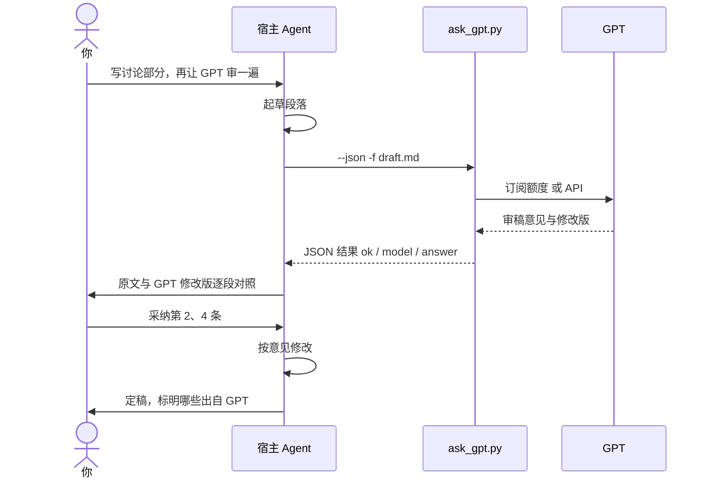
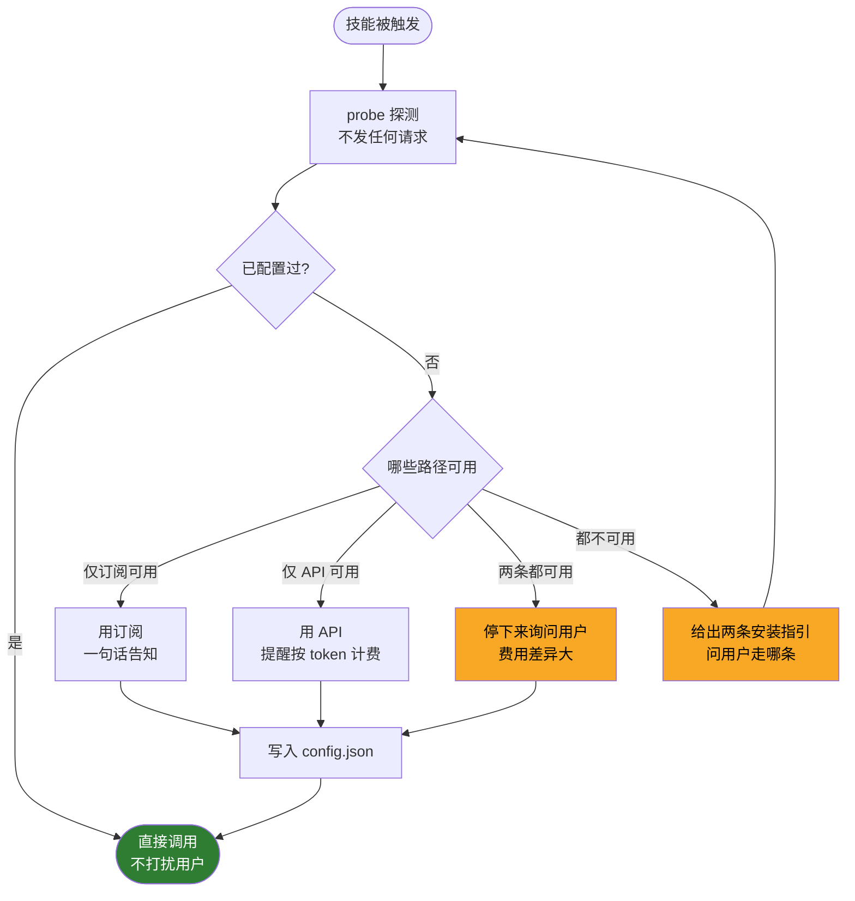
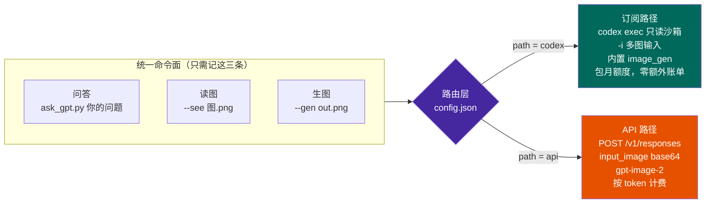

<div align="center">


# ask-gpt

**让 GPT 加入当前对话的工作流 —— 任何支持 skill 与 shell 的 AI agent 都能调用你自己的 OpenAI 账号**

问答 · 读图 · 生图 ｜ 订阅额度或 API Key 双路径 ｜ 模型按账号实时拉取

[](SKILL.md)
[](https://www.python.org/)
[](scripts/ask_gpt.py)
[](LICENSE)

</div>

---

## 为什么需要它

你在用的 AI agent —— Claude Code、WorkBuddy，或任何能装 skill、能跑 shell 的助手 —— 很强，但有几类事一个模型干不好：

| 场景 | 问题 |
|---|---|
| **事实核查** | 单一模型的幻觉自己查不出来，需要另一个模型**独立作答**再比对 |
| **论文润色** | 不同模型的语感差异很大，对照两版再定稿，质量明显高于单版 |
| **识图 / 生图** | 有时就是想听 GPT 对一张图的判断，或者想要它的出图风格 |

常见做法是**切到另一个窗口**问 GPT，再把结果复制回来 —— 上下文断了，也说不清哪段是谁写的。

ask-gpt 让 GPT **直接在当前对话里**参与进来：宿主 agent 负责对话和决策，把某一步交给 GPT，结果回到同一个对话继续往下走。

而且不用再掏一份 API 费：很多人已经在付 ChatGPT 包月订阅，那份额度本来就能用。

```
已有 ChatGPT 订阅  → 走 Codex CLI，消耗包月额度，不产生任何额外账单
只有 API Key      → 走 OpenAI API，按 token 计费，生图尺寸可控
两条都有          → 停下来问你走哪条（费用差异大，不替你决定）
```

---

## 让 GPT 参与工作流

一个典型的例子：写论文讨论部分，起草和修改由宿主 agent 做，审稿交给 GPT，你只做决定。



整个过程在**一个对话**里完成，每一步是谁做的都清清楚楚。

技能内置五种协作方式，宿主 agent 会按场景选：

| 方式 | 做法 |
|---|---|
| **直接提问** | 你的问题原样转发，不加不减，回答标明出自 GPT |
| **第二意见（盲评）** | 只发原始问题让 GPT 独立作答，**不附上宿主 agent 的结论**，避免锚定；再汇报一致点、分歧点、综合判断 |
| **审稿 / 对照润色** | GPT 修改版与原文逐段对照，交你定稿，**不擅自合并两版** |
| **识图** | 图和问题一起发；复杂影像先问清你想让 GPT 看什么 |
| **流水线中的一步** | 宿主起草 → GPT 审 → 宿主修改 → 你定稿；或 GPT 出图 → 宿主嵌入文档 |

---

## 适用于哪些 agent

ask-gpt 本体是一个**零依赖的 Python 命令行脚本**，不绑定任何一家的 agent。宿主满足下面四条就能用：

| 要求 | 说明 |
|---|---|
| 能执行 shell 命令 | 只需要 `python3`（3.8+，标准库） |
| 能向用户提问 | 选择卡片、按钮或对话里直接问都行 |
| 沙箱放行网络 | 订阅路径访问 `chatgpt.com`；API 路径访问 `api.openai.com` |
| 沙箱能读到凭据 | 订阅路径读 `~/.codex/`；API 路径读环境变量 `OPENAI_API_KEY` |

- **支持 skill 的 agent**（Claude Code、WorkBuddy 等）：把整个目录放进它的 skills 目录，`SKILL.md` 会告诉它何时触发、怎么问你、怎么解析结果
- **不支持 skill 的 agent**：只要能跑 shell，直接调脚本；把 `SKILL.md` 的内容作为说明交给它即可

沙箱里的 home 目录或 PATH 和你的机器不一样时，用 `CODEX_HOME` 指向 Codex 数据目录，用 `ASK_GPT_CODEX` 指定 codex 可执行文件。

---

## 核心设计：探测在前，追问在后

每次都问"你有订阅还是 API"很烦；完全不问又会在费用上替你做决定。所以按探测结果分流，**只在真正需要决策时才开口**：



<sub>🟡 黄色 = 需要你参与的节点，其余全自动</sub>

### 脚本绝不等 stdin

技能脚本跑在 agent 的工具调用里，**没有交互式终端**。脚本里只要有一处 `input()`，整个调用就会挂死。所以分工是：

- **脚本**：全程非交互，只负责探测（`--probe`）、落盘（`--set-path`）、执行
- **宿主 agent**：用自己的方式在对话里问你，拿到答案再调脚本落盘

---

## 架构：一套命令，两条路径



| 能力 | 订阅路径 `codex` | API 路径 `api` |
|---|---|---|
| **计费** | ChatGPT 包月额度，**零额外账单** | **按 token 计费** |
| **模型** | 按账号实时拉取（`codex debug models`） | 按账号实时拉取（`GET /v1/models`） |
| **问答** | `codex exec` 只读沙箱 | `POST /v1/responses` |
| **读图** | `codex exec -i`（客户端读文件后上传，可多张） | `input_image` base64 data URL |
| **生图** | 内置 `image_gen` 工具 | `gpt-image-2` |
| **生图尺寸** | 不可指定 | `--size` 精确控制 |
| **额度耗尽** | `usage limit`，等订阅周期重置 | `429` 限速或余额不足 |

---

## 模型：按账号实时拉取，不写死

模型在不断更新。脚本**不维护任何模型白名单**，每次都从你的账号拉当前可用的目录：

```bash
python3 scripts/ask_gpt.py --list-models
```

```
路径 codex 当前可用模型 —— 来源：账号实时目录（codex debug models）
 ★ gpt-6.1-sol          Latest workhorse model for coding and everyday work.  [ctx 500000, 支持图像输入]
   gpt-6-astra          Frontier intelligence for the most demanding work.  [ctx 272000, 支持图像输入]
   gpt-6-sol            Previous generation workhorse model.  [ctx 272000, 支持图像输入]
   gpt-6-luna           Fast and affordable model for easier tasks.  [ctx 272000, 支持图像输入]
   gpt-5.6-sol          Older generation workhorse model.  [ctx 272000, 支持图像输入]
   …

★ = 当前默认（你的 Codex 配置）
```

<sub>以上是 2026-10-24 某个 ChatGPT 账号的快照，你看到的会随账号权益和 OpenAI 上线情况变化。</sub>

- **默认模型**：订阅路径直接用你 `~/.codex/config.toml` 里的 `model`，所以你在 Codex 里换了模型，这里自动跟着换
- **换模型**：`--set-model <模型名>` 持久，`-m <模型名>` 仅本次
- **描述来自 OpenAI 官方目录**，不是脚本自己编的

> **为什么坚持不写死？** 本项目上一版写死了三个模型并配了"最强 / 均衡 / 最便宜"的说明。不到两个月，OpenAI 官方目录里这三个的描述就全变成了 **"Older …"**，新的一代已经上线，而写死的清单把它们挡在了外面。

---

## 安装

### 1. 装技能

```bash
git clone https://github.com/Stefansong/ask-gpt.git

# Claude Code
cp -r ask-gpt ~/.claude/skills/ask-gpt

# 其他支持 skill 的 agent：放进它的 skills 目录（参照对应文档）
# 不支持 skill 的 agent：直接调用 ask-gpt/scripts/ask_gpt.py 即可
```

> ⚠️ 如果这是你账号里的**云端同步技能**，直接改本地文件**不会持久** —— 下次同步会被覆盖。要改版本请改云端。

### 2. 配认证（二选一，也可以都配）

<table>
<tr><th>订阅路径（推荐，不额外花钱）</th><th>API 路径（按量计费）</th></tr>
<tr valign="top"><td>

```bash
brew install --cask codex
# 或 npm install -g @openai/codex

codex login
# 无浏览器环境：
# codex login --device-auth
```

需 ChatGPT Plus / Pro / Business 等付费账号

</td><td>

```bash
echo 'export OPENAI_API_KEY=sk-...' >> ~/.zshrc
source ~/.zshrc
```

在 [platform.openai.com](https://platform.openai.com) 创建 Key

</td></tr>
</table>

### 3. 探测

```bash
python3 scripts/ask_gpt.py --probe
```

```
订阅(codex): 可用 — Logged in using ChatGPT
  使用: /opt/homebrew/bin/codex (0.164.0) | 默认模型: gpt-6.1-sol
  另有旧副本: ~/.nvm/versions/node/v20.19.5/bin/codex (0.151.0) —— 已自动跳过
  账号可用模型: gpt-6.1-sol, gpt-6-astra, gpt-6-sol, gpt-6-luna, …
API Key:     不可用 — OPENAI_API_KEY 未设置
```

之后平时直接说「**问问 GPT**」「**让 GPT 看看这张图**」，技能会自动触发。

---

## 使用

### 问答

```bash
python3 scripts/ask_gpt.py "2 的 10 次方是多少？"
python3 scripts/ask_gpt.py -f prompt.md          # 长内容走文件，避免 shell 转义
```

```
2 的 10 次方是 1024。
[路径: ChatGPT 订阅 via codex exec，模型 gpt-6.1-sol]
```

### 读图

```bash
python3 scripts/ask_gpt.py --see 图.png "这张图说明了什么？"
python3 scripts/ask_gpt.py --see 图1.png --see 图2.png -f q.md   # 多张重复 --see
```

<table>
<tr><td width="140"></td><td>

```
$ ask_gpt.py --see demo-see-colors.png \
    "左右两半各是什么颜色？只答两个颜色词。"

红色 蓝色
[路径: ChatGPT 订阅 via codex exec，模型 gpt-6.1-sol，1 张图]
```

</td></tr>
</table>

### 生图

```bash
python3 scripts/ask_gpt.py --gen out.png "一只橘色的猫坐在窗台上，简洁扁平插画风格"
python3 scripts/ask_gpt.py --gen out.png --size 1536x1024 -f desc.txt   # --size 仅 API 路径
```

<table>
<tr><td width="320"></td><td>

```
saved: /abs/path/out.png
[生图路径: ChatGPT 订阅 via codex exec，
 image_gen（Codex 内置）]
```

**生完一定要核对文件存在** ——
订阅路径的 `image_gen` 偶尔只给预览不落盘。

这张图本身就是测试产物，随后又用
`--see` 反向识别为"橘白相间的猫坐在
窗台上" —— 生图与读图闭环验证通过。

</td></tr>
</table>

### 给 agent 用：`--json`

任何调用加 `--json` 都返回稳定的结构，比解析文本可靠：

```bash
python3 scripts/ask_gpt.py --json "Reply with exactly: OK"
```

```json
{
  "ok": true,
  "mode": "ask",
  "path": "codex",
  "billing": "subscription",
  "model": "gpt-6.1-sol",
  "answer": "OK",
  "images_in": []
}
```

| 字段 | 含义 |
|---|---|
| `ok` | 是否成功；失败时另有 `error` |
| `mode` | `ask` / `see` / `gen` |
| `path` / `billing` | `codex` + `subscription`，或 `api` + `per-token` |
| `model` | **实际使用的模型名**，署名就用它 |
| `answer` / `image` | 文本回答 / 生成图片的绝对路径 |

退出码：`0` 成功，`1` 调用失败，`2` 无可用认证或未配置。

### 配置管理

```bash
python3 scripts/ask_gpt.py --set-path codex           # 选路径
python3 scripts/ask_gpt.py --set-model <模型名>        # 选模型
python3 scripts/ask_gpt.py --path api -m <模型名> "问题"   # 本次临时覆盖，不改默认
python3 scripts/ask_gpt.py --show-config
python3 scripts/ask_gpt.py --reset-config
```

---

## 必守规则

技能里写进了几条硬约束，目的是不让便利性盖过可靠性：

- 🏷️ **署名** —— 凡出自 GPT 的内容都标明「GPT（模型名，订阅/API 路径）」，与宿主 agent 自己的观点分开，绝不静默混用
- 💰 **费用** —— API 路径按 token 计费。批量调用、发大图或连续生图前，先说明大致用量
- 🔒 **隐私** —— 发出前确认不含患者可识别信息（PHI）、密钥、未发表数据；医学影像先去标识化
- ❌ **失败就是失败** —— 如实报错并给修复命令，**绝不编一个"GPT 的回答"顶替**，也不在你不知情时悄悄换模型重试

### ⚠️ 代理会改写流量

环境里设了 `HTTPS_PROXY` 或 `OPENAI_BASE_URL` 时，请求可能**经第三方网关转发而非直连 OpenAI**。`--probe --json` 会把这几个变量的状态一并返回：

```json
"proxy": {"HTTP_PROXY": true, "HTTPS_PROXY": true, "OPENAI_BASE_URL": false}
```

**"数据只发给 OpenAI"在有代理的机器上并不成立。** 开发本项目时就实测到请求被转发到了一个第三方 LLM 网关，而 CLI 自身对此毫不知情。

---

## 报错速查

<details>
<summary><b>订阅路径</b></summary>

| 报错 | 原因 / 处理 |
|---|---|
| `usage limit ... try again at HH:MM` | 包月额度用尽，等重置；若也有 API Key 可临时 `--path api` |
| `model_not_found` / `not supported when using Codex` | 多半是**客户端太旧、不认识新模型**。看 `--probe` 用的是哪份 codex；若都旧就升级 |
| `Model metadata for … not found` | 同上，旧客户端的内置目录里没有这个模型 |
| `未找到 codex 可执行文件` | 沙箱里没有 codex 或 PATH 不同，用 `ASK_GPT_CODEX` 指定 |
| 读图时 GPT 说"看不到图" | 检查图片路径；脚本已自动把相对路径转绝对路径 |

</details>

<details>
<summary><b>API 路径</b></summary>

| 报错 | 原因 / 处理 |
|---|---|
| `401` | Key 无效或过期 |
| `429` | 限速或余额不足 |
| `model_not_found` | 用 `--list-models` 看当前可用模型 |
| `连不上 OpenAI` | 检查沙箱网络与 `HTTPS_PROXY` |

</details>

---

## 实测状态

| 测试 | 订阅路径 | API 路径 |
|---|---|---|
| 问答（`gpt-6.1-sol`） | ✅ | ⚠️ 仅验证请求构造与错误处理 |
| 读图（含相对路径） | ✅ 左红右蓝 → "红色 蓝色" | ⚠️ 未经真机验证 |
| 生图 | ✅ PNG 落盘 | ⚠️ 未经真机验证 |
| 生图 ↔ 读图闭环 | ✅ 生成的鲸鱼被识别为"一只蓝色的鲸鱼" | — |
| 临时换模型（`-m`） | ✅ | — |
| 账号模型实时拉取 | ✅ | ⚠️ 未经真机验证 |
| 多份 codex 时选最高版本 | ✅ 跳过 npm 的 0.151.0，用 brew 的 0.164.0 | — |
| `--json` 成功 / 失败结构 | ✅ | ✅ |
| 两条都可用时拒绝自动选 | ✅ 退出码 2 | |

- **API 路径的真实响应未经真机验证** —— 开发环境没有 API Key
- **目前只在 Claude Code 中实测过**；WorkBuddy 等其他 agent 尚未实测。如果你在别的 agent 里跑通了（或踩到坑），欢迎开 issue

---

## 踩过的坑

这些都是开发过程中真实遇到的，写在这里免得你再踩一遍。

<details>
<summary><b>1. 机器上有好几份 codex，PATH 里排第一的是旧的</b></summary>

```
~/.nvm/versions/node/v20.19.5/bin/codex   0.151.0   ← npm 装的，PATH 里排在前面
/opt/homebrew/bin/codex                   0.164.0   ← brew 装的，排在最后
```

`shutil.which("codex")` 永远拿到 npm 的旧版。旧客户端调新模型时，服务端返回 `model_not_found`，看起来像"订阅账号不支持这个模型" —— 其实只是客户端太旧。更隐蔽的是：**测试时只要顺手改了 PATH 就会成功**，于是很容易误判成间歇性的网络问题。

现在脚本会找出机器上所有 codex，**取版本最高的那份**，并在 `--probe` 里把其余副本列出来。

</details>

<details>
<summary><b>2. 写死的模型清单两个月就过期</b></summary>

上一版写死了三个模型。不到两个月，OpenAI 官方目录里这三个的描述就全变成了 "Older …"，新一代已经上线。更糟的是，那一版的"动态发现"其实是拿硬编码字典过滤缓存 —— 看着动态，新模型却永远进不来。

现在：订阅路径用 `codex debug models` 从服务端拉账号目录，只按 `visibility` 滤掉内部模型；API 路径查 `/v1/models`；默认模型跟随你的 Codex 配置。

</details>

<details>
<summary><b>3. 隔离运行目录导致相对路径失效</b></summary>

为了不让 GPT 碰到你的项目文件，订阅路径在**临时空目录**里运行 codex：

```python
cmd = [exe, "exec", "-", "--skip-git-repo-check", "--ephemeral",
       "-s", "read-only", "-C", workdir]
```

副作用是 `--see assets/x.png` 这种相对路径在那个目录里解析不到 —— codex 不报错，GPT 只会说"请重新上传图片"。现在所有图片路径都先转成绝对路径。

</details>

<details>
<summary><b>4. argparse 的 nargs="+" 吞掉了问题文本</b></summary>

```python
ap.add_argument("--see", nargs="+")          # ✗ 会把后面的问题当成第二张图
ap.add_argument("--see", action="append")    # ✓ 多图就重复 --see，和 codex 的 -i 一致
```

</details>

---

## 致谢与声明

- 两条路径分别基于 [OpenAI Codex CLI](https://github.com/openai/codex) 与 [OpenAI Platform API](https://platform.openai.com)
- 本仓库的插图由本技能自身的生图功能产出（订阅路径，`image_gen`）
- 与 OpenAI、Anthropic 及任何 agent 厂商均无隶属关系；使用时请遵守各自服务条款
- 医学示意图若用于论文或汇报，请在图注注明"AI 生成，仅供参考"

## License

[MIT](LICENSE)
